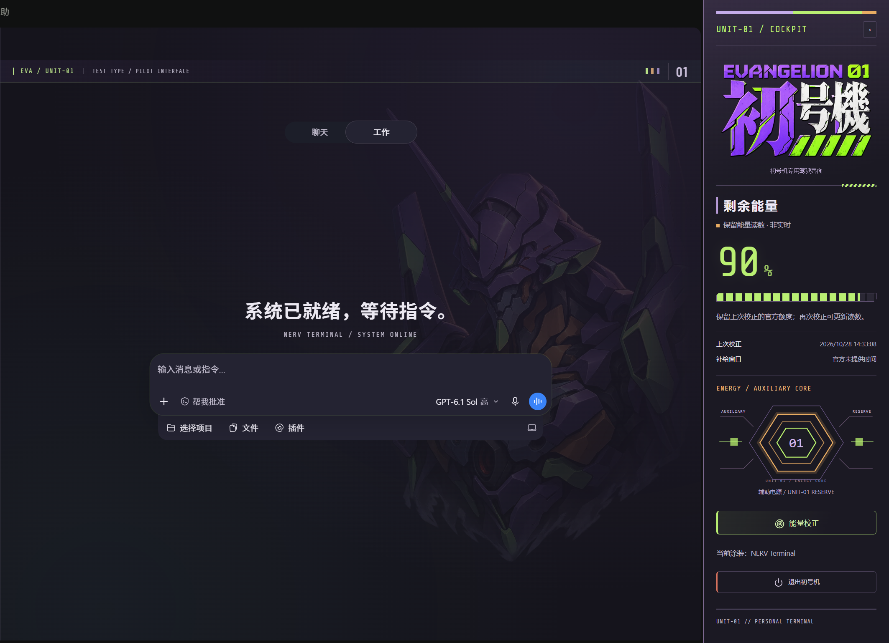
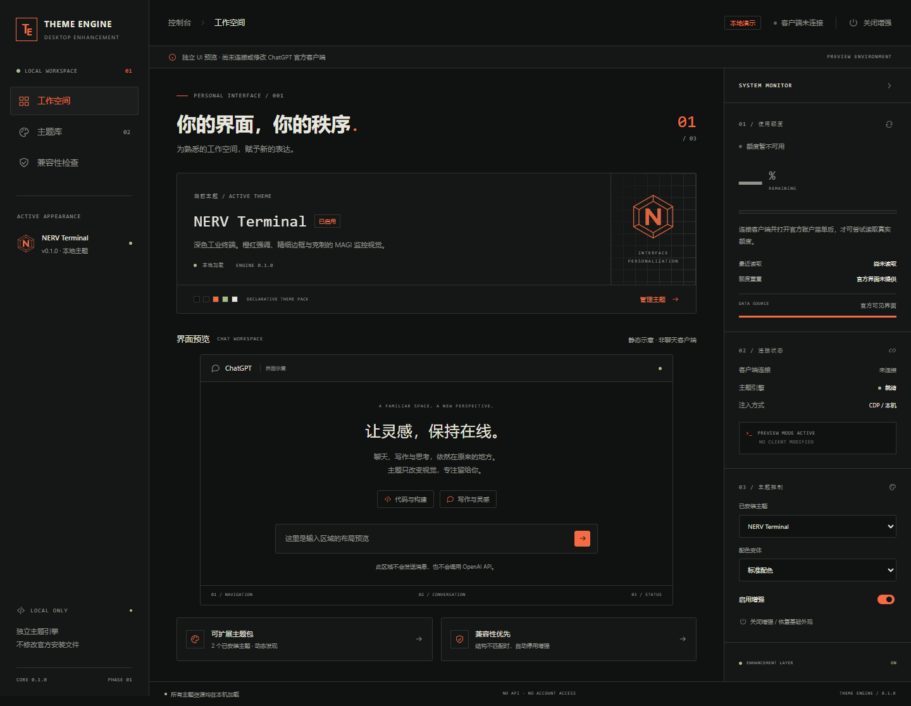

# ChatGPT Desktop Theme Engine

可扩展的 Windows 客户端视觉增强原型。核心引擎、声明式主题包和功能模块彼此分离，首个主题为 **NERV Terminal**，另附 **Quiet Default** 验证主题切换。

**已在本机真实 ChatGPT 客户端完成 NERV 注入、面板布局、收起、恢复和头像菜单额度读取验证。** 当前版本的显示名称是 ChatGPT，内部包名是 `OpenAI.Codex 26.1007.2314.0`；不能根据包名认定没有安装 ChatGPT。完整聊天／Work 工作流仍待验证。详情见 [兼容性记录](docs/compatibility.md)。

## 直接测试已安装客户端

NERV 0.7 采用参考图风格的整幅紫白绿“初号機”标识，并将左右品牌区分为 NERV 铭牌与彩色初号机驾驶舱，加入浅紫装甲、荧光绿能量条、琥珀核心纹样和珊瑚色退出细节。对话区保留炭灰、烟紫与青灰分层和低透明度初号机暗纹。[查看真实驾驶舱面板](docs/nerv-client-panel.png)。完整素材来源见 [素材记录](themes/nerv/assets/SOURCES.md)。


上图直接截取当前客户端**聊天模式**的新聊天首页与右侧驾驶舱，包含初号机暗纹、当前品牌图和输入提示；为保护隐私，左侧历史列表与账号区域未包含在画面中。它与下面的独立主题管理页面是两个不同界面。

<details>
<summary>查看同一主题的 Work 模式实机效果</summary>



Work 模式的原生输入框与工具行布局不同，主题保留这两种原生布局。

</details>

在项目根目录双击 **[启动初号机主题.cmd](启动初号机主题.cmd)**；原“测试 NERV 主题.cmd”也已更新为相同流程。无需查找或进入 WindowsApps，也无需更改其文件权限。

1. 脚本自动从包 Manifest 获取 ChatGPT 的真实路径和启动 ID。
2. 如果 ChatGPT 正在运行，先保存工作并从托盘／菜单正常退出；脚本会等待，不强制结束进程。
3. 通过 Windows 的 Store 应用启动接口打开客户端，只为这次启动启用 `127.0.0.1:9335` 调试端口。
4. 等待主窗口加载，检查页面结构，只有一个兼容主窗口时应用主题。快捷窗口和文档窗口不会被误选。
5. 正常启动只检查当前页面可读性、输入区可见性和面板布局，随后保持主题启用。完整的恢复／重装自检仅在手动执行 verify-auto 时运行。

点击右侧初号机驾驶舱的“能量校正”，会自动打开官方头像菜单，等待并读取带“使用情况 / Usage”和“剩余 / remaining”标签的额度，再收起本次打开的菜单。只在点击时主动打开；后台检查不会弹菜单。读不到时显示原因或保留带时间的缓存，切换聊天布局也会保留缓存；主动关闭增强会清除本次会话缓存。

恢复可双击 **[恢复原版界面.cmd](恢复原版界面.cmd)** 或点击新增面板的恢复按钮。要同时关闭调试端口，完整退出 ChatGPT，再从开始菜单正常启动。刷新页面会清除本次主题，但不会关闭进程的调试端口。

等价终端命令：`npm run test:client`。只定位、不启动：`powershell -NoProfile -ExecutionPolicy Bypass -File scripts/test-client.ps1 -CheckOnly`。

## 运行

需要 Node.js 22.14+、npm、Windows PowerShell。UI 浏览器测试默认使用已安装的 Microsoft Edge。

```powershell
npm install
npm run dev
```

访问 **http://127.0.0.1:5173**。服务仅监听本机。页面明确标记为演示，不实现聊天、不调用 OpenAI API、不登录账号。额度初始为“不可用”，不显示虚构的剩余百分比。

生产模式仍需本地 Node 服务，以便动态发现主题目录：

```powershell
npm run build
npm start
```

不要通过 `file://` 打开 HTML，也不要只把 `dist/` 放到没有主题目录的静态托管环境。`npm start` 从项目根目录启动，同时读取 `themes/`；新增主题无需重新构建，在主题库点击“重新扫描”即可。

在当前受限开发环境中，如果系统 npm 启动器报 `EPERM: lstat C:\Users\Tal`，可直接使用已安装的 npm CLI，功能相同：

```powershell
& 'C:\Program Files\nodejs\node.exe' 'C:\Program Files\nodejs\node_modules\npm\bin\npm-cli.js' run dev
```

## 已实现

- 按目录动态发现主题、严格 Manifest 校验、引擎版本约束、无效包隔离、主题删除后的回退。
- NERV 深色工业风主题、EVA-01 / EVA-00 配色变体，以及布局、字体、圆角均可独立配置的默认主题。
- 主题库、切换、重新扫描、本地偏好保存；存储损坏或不可写时降级到会话设置。
- 可折叠监控栏、声明式功能插槽、额度数据接口、真实值／缓存／不可用三种状态。
- 官方 DOM 兼容适配、可撤除注入；设置等不支持的页面暂停布局增强，保留配色以避免闪白，返回聊天后重新绑定。回复独立调色板会同步适配；流式文字渐入期间等待动画结束并自动复查，确认稳定的可读性失败后才完整撤除。本机端口和目标校验。
- 独立的页面加载后启动覆盖层接口，支持开关、跳过、时长和减少动态效果偏好。音效与真正的启动前动画暂未实现。

<details>
<summary>独立主题管理页面截图（早期演示，不代表客户端外观）</summary>



这是用于主题发现、设置和兼容性说明的本地管理界面。其布局、左侧导航和监控模块不等同于注入 ChatGPT 后的客户端界面；当前客户端实机效果见文首截图。

</details>

## 关闭与恢复

本地演示：点击顶部“关闭增强”或面板恢复按钮，移除主题变量和 CSS，隐藏监控栏、恢复基础布局。状态会保存；在主题库重新勾选“启用视觉增强”即可恢复。**Quiet Default 是另一个主题，不等于原版 ChatGPT。** 停止服务用终端 `Ctrl+C`。

真实客户端：点击驾驶舱中的“退出初号机”（撤除主题、恢复原版界面），或运行下述 `restore` 命令。页面刷新或完整退出客户端也会清除本次内存注入；本工具不注册跨刷新启动脚本。结束连接工具不会自动清除已经注入的页面，应先执行恢复。

## 实验性客户端工具

```powershell
npm run doctor
npm run client -- probe --port 9335
npm run client -- inspect --port 9335
npm run client -- verify-auto --port 9335 --theme nerv
npm run client -- apply --port 9335 --target TARGET_ID --theme nerv
npm run client -- apply --port 9335 --target TARGET_ID --theme nerv --variant eva-01
npm run client -- restore --port 9335 --target TARGET_ID
```

启动失败时，具体检查项写入 `.local-tools/client-last-result.json`。`verify-auto` 是会撤除并重装主题的完整自检，不是日常启动入口。

`probe` 和 `inspect` 不修改渲染页面；inspect 只返回结构标记，不读取消息、输入值或账号内容。自动测试入口会定位并启动客户端，但不强制重启运行中的应用、不修改快捷方式或官方配置。仅接受完全监听回环地址的 CDP 端点；若 Windows 无权读取监听地址，会拒绝继续。仅允许 `app://` 或 `https://chatgpt.com` 的候选目标，随后必须通过集中式 DOM 检查。自动应用必须恰好有一个匹配主窗口；多个匹配窗口时需用 `--target` 明确选择。自动恢复只处理本工具拥有的增强层。

此阶段 CLI 主题选择通过参数传入；注入面板的折叠状态仅在当前页面有效。预览管理器保存的偏好不会自动同步给官方客户端。实机已确认恢复后原编辑器和导航 DOM 保留，并验证了账户菜单额度读取、设置往返及已知历史会话切换；没有发送消息。完整 Work、模型切换与聊天流程仍需继续验证。

## 测试

```powershell
npm run build
npm test
npm run test:ui
```

浏览器测试使用 Edge；改用 Chrome 可设置 `$env:BROWSER_CHANNEL='chrome'`。当前验证结果：TypeScript 和生产构建通过，27 项模块测试、44 项桌面／窄屏浏览器测试通过，包含流式渐入、后台暂停恢复、来源标签、首页文案、输入提示、文档分栏及页面切换回归。测试夹具中的额度数字为合成数据；真实客户端仅显示读取到的官方值，预览页面不会加载测试额度。

结构与扩展方法见 [架构](docs/architecture.md)、[添加主题](docs/theme-authoring.md)。

截图来源与更新方式：

- `docs/preview-desktop.png`：真实客户端首页。启用主题、打开空白新聊天并关闭菜单和文档预览后，运行 `node scripts/run.mjs capture-client --homepage`，检查 `.local-tools/client-homepage.png` 后再复制到该路径。该命令只截取聊天主区与驾驶舱，不包含左侧历史与账号区域；有草稿、附件、可见对话或预览时拒绝截图。
- `docs/preview-work.png`：同一客户端切换到 Work 模式后的首页，按上述实机截图流程更新。
- `docs/manager-desktop.png`、`docs/manager-mobile.png`：早期独立管理页面演示。启动本地服务后执行 `node scripts/capture.mjs` 可重新生成管理页面截图，不会覆盖实机图。
